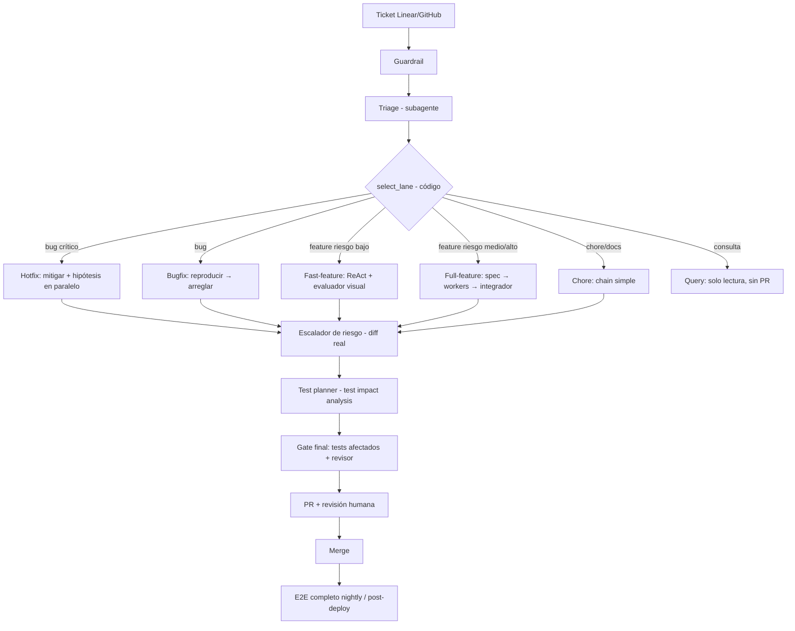

# dev-harness

Arnés agéntico para **desarrollar y mantener un sistema** a partir de tickets (features, bugs, consultas y chores). Es un **plugin de Claude Code**: lo instalás una vez y lo aplicás a cualquier repo con una carpeta `.harness/`. Está pensado para correr dentro de [Orca](https://github.com/stablyai/orca), con un worktree por ticket.

> **Versión infantil.** Es una guardia de hospital. En la puerta te revisan (guardrail), la enfermera de triage mira qué tenés y qué tan grave es, y según eso vas a curaciones rápidas, al consultorio o a terapia intensiva. A nadie le hacen una resonancia por un raspón, y antes de darte el alta siempre te revisa un médico (el gate y la revisión humana).

## Principio

**El esfuerzo es proporcional al riesgo.** Cada ticket recibe el patrón, los permisos y los tests que necesita:

- Lo que **decide el LLM** (clasificar, investigar, programar, evaluar) está en `.md`: subagentes y skills.
- Lo que **tiene que cumplirse siempre** (el carril, el escalado de riesgo, qué tests corren, que no se termine sin gate y que no se haga push a `main`) está en **TypeScript**, como tools MCP (tool use) y hooks.



Cada carril tiene un **loop interno barato** (`run_checks`: tipos y unit de los archivos afectados) y pasa **una sola vez** por el **gate** (`run_gate`). La suite e2e completa nunca bloquea a un agente.

## Qué hay en el repo

| Pieza | Dónde | Tipo |
|---|---|---|
| Triage, investigador de hotfix, reproductor, fixer, implementador UI, evaluador visual, planner, worker, integrador, revisor, respondedor | `agents/*.md` | Subagentes |
| Entrada (`handle-ticket`), un playbook por carril, `open-pr`, `setup-harness` | `skills/*/SKILL.md` | Skills |
| Política de carriles, escalador de riesgo, test planner, gate | `src/core/` | TypeScript |
| Tools para el agente (tool use) | `src/mcp/server.ts` → `.mcp.json` | Servidor MCP |
| Guardas (`PreToolUse`) y gate obligatorio (`Stop`) | `src/hooks/` → `hooks/hooks.json` | Hooks |
| Memoria de trabajo, episódica y de lecciones | `src/memory/` | TypeScript |
| Configuración de ejemplo (Postgres, NestJS, Next.js, Docker, Redis, nginx) | `templates/.harness/` | Plantilla |

`dist/` tiene los bundles ya compilados, así el plugin corre con `node` sin `npm install`.

### Tools MCP

| Tool | Para qué |
|---|---|
| `start_ticket` | Registra el ticket en el worktree y devuelve tickets parecidos de la memoria |
| `select_lane` | Recibe la clasificación del triage; **el código** decide el carril |
| `get_ticket` / `update_ticket_state` | Memoria de trabajo compartida: hipótesis, descartes, plan |
| `check_risk` | Diff real contra rutas críticas y compartidas |
| `plan_tests` | Qué tests correrían (sin correrlos) |
| `run_checks` | Loop interno: barato, nunca corre e2e |
| `run_gate` | Gate final: revalida el riesgo (puede re-carrilar), corre los tests relevantes con presupuesto de tiempo, cuenta intentos y guarda el episodio |
| `take_screenshot` | Captura para el evaluador visual |
| `toggle_flag` | Mitigación de hotfix (requiere aprobación humana) |
| `search_past_tickets` / `get_lessons` / `propose_lesson` | Memoria episódica y procedural |
| `close_ticket` | Cierra consultas respondidas o tickets escalados |

### Hooks

- **`PreToolUse`** bloquea:
  - push a ramas protegidas, `push --force` y `gh pr merge`;
  - los comandos prohibidos de la config (suite e2e completa, `docker compose down -v`, `DROP TABLE`, `FLUSHALL`…);
  - cualquier edición de archivos en el carril de consulta;
  - que el agente edite `.harness/config.json` o las lecciones aprobadas.
- **`Stop`** no deja terminar al agente sin un gate OK para el diff **actual**. Si el código cambió después del gate, lo vuelve a exigir. Al superar el tope de intentos, deja salir y marca el ticket como escalado.

Fuera de un ticket activo, los hooks no hacen nada: podés usar Claude Code normalmente en el mismo repo.

## Memoria

| Tipo | Qué guarda | Dónde |
|---|---|---|
| De trabajo (pizarrón) | Carril, intentos, bitácora de hipótesis y descartes | `~/.claude/plugins/data/…/state/<repo>/<ticket>.json`, fuera de los worktrees, compartida entre agentes |
| Del repo (libro) | Convenciones, arquitectura | `CLAUDE.md` del sistema |
| Episódica (diario) | Un `.md` por ticket resuelto: síntoma, causa raíz, fix, qué no funcionó | `.harness/memory/episodes/` e `incidents/`, se commitea con el PR |
| Procedural (reglas de la pared) | Lecciones aprendidas | `.harness/memory/lessons/`: los agentes proponen en `pending/` y **un humano aprueba** en `approved.md` |

## Instalación

En Claude Code:

```
/plugin marketplace add senkuch4n/dev-harness
/plugin install dev-harness@senkuch4n
```

Para que todo el equipo lo tenga al abrir el repo del sistema, agregá esto a `.claude/settings.json` de ese repo:

```json
{
  "extraKnownMarketplaces": {
    "senkuch4n": { "source": { "source": "github", "repo": "senkuch4n/dev-harness" } }
  },
  "enabledPlugins": { "dev-harness@senkuch4n": true }
}
```

Para desarrollar el arnés en local: `claude --plugin-dir /ruta/a/dev-harness`.

## Aplicarlo a tu sistema

1. En el repo del sistema: `/dev-harness:setup-harness`. Copia la plantilla y propone una config según la estructura real del repo.
2. Revisá `.harness/config.json`:
   - `criticalPaths`: auth, guards, pagos, migraciones, Dockerfiles, compose, nginx, CI.
   - `testImpact`: carpeta → tags de Playwright (`@auth`, `@users`…). **Si tus e2e no tienen tags, este es el cambio que más tiempo ahorra.**
   - `commands`: cómo corren lint, tipos, unit (`--findRelatedTests`), integración (supertest de NestJS) y e2e filtrado.
   - `budgets`: minutos máximos de gate por carril.
3. Commiteá `.harness/` y agregá `.harness/run/` al `.gitignore`.

La plantilla supone un monorepo con `apps/api` (NestJS + Jest), `apps/web` (Next.js), `e2e/` (Playwright) y un `docker-compose.test.yml` con Postgres y Redis. Si tu estructura es otra, ajustá las rutas y los comandos.

## Uso en Orca

1. Abrí un worktree desde el ticket de Linear o el issue de GitHub.
2. En el agente: `/dev-harness:handle-ticket LIN-123`.
3. El arnés trae el ticket, lo valida, lo clasifica, elige el carril y sigue el playbook. Para revisar el diff y aprobar el PR usás Orca.

Para varios tickets a la vez, usá un worktree por ticket: la memoria de trabajo es por ticket y no se pisa.

## Desarrollo

```bash
npm install
npm run check   # tipos + tests (unitarios e integración con repo git temporal, hooks y servidor MCP) + build
```

Después de cambiar `src/`, corré `npm run build` y commiteá `dist/`.

## Límites conocidos

- Las guardas de Bash usan expresiones regulares: frenan errores del agente, pero **no son un límite de seguridad**. Mantené el sandbox de Orca y los permisos de Claude Code, y no le des al agente credenciales de producción.
- El flujo entre pasos lo guía una skill, así que lo sigue el modelo. Lo que no puede saltearse (carril, gate, guardas) lo controla código.
- Los comandos de Linear se descubren con `orca linear --help` en lugar de estar fijos, porque la CLI de Orca cambia seguido.
